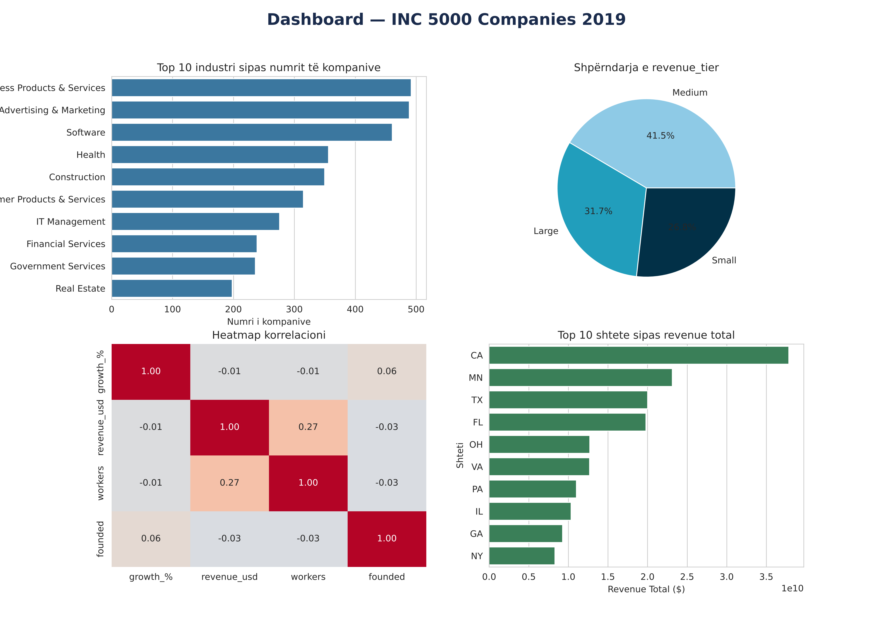
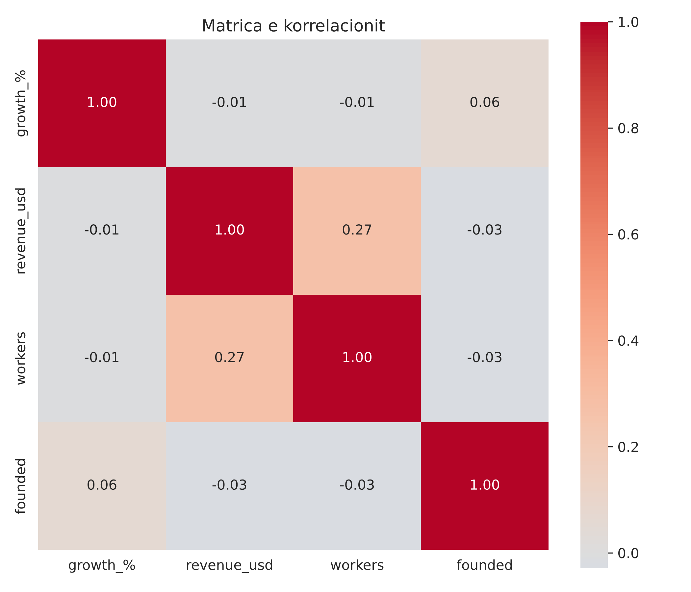
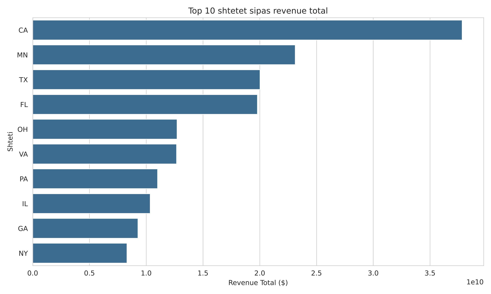
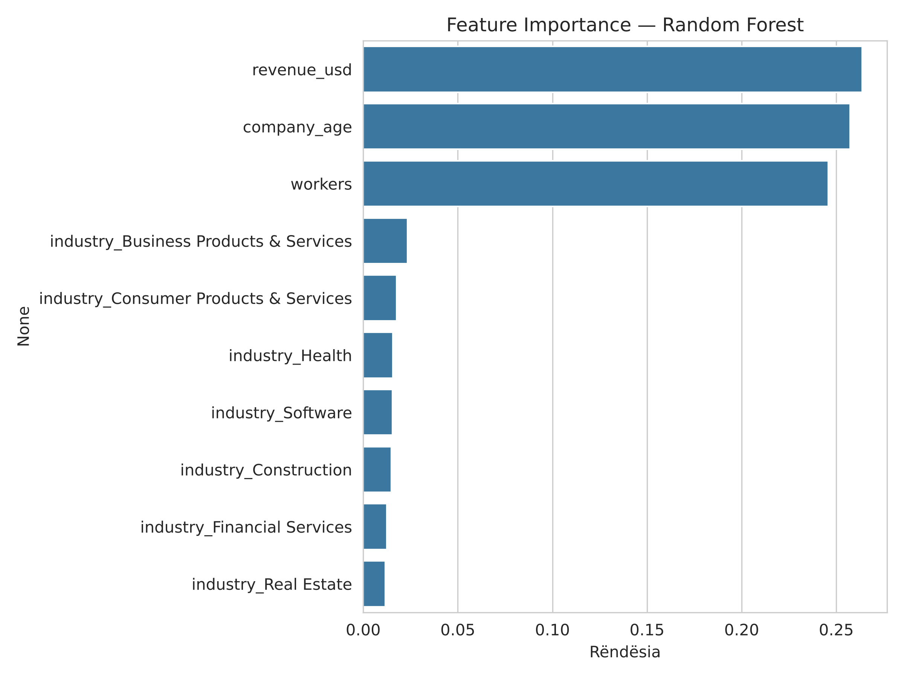
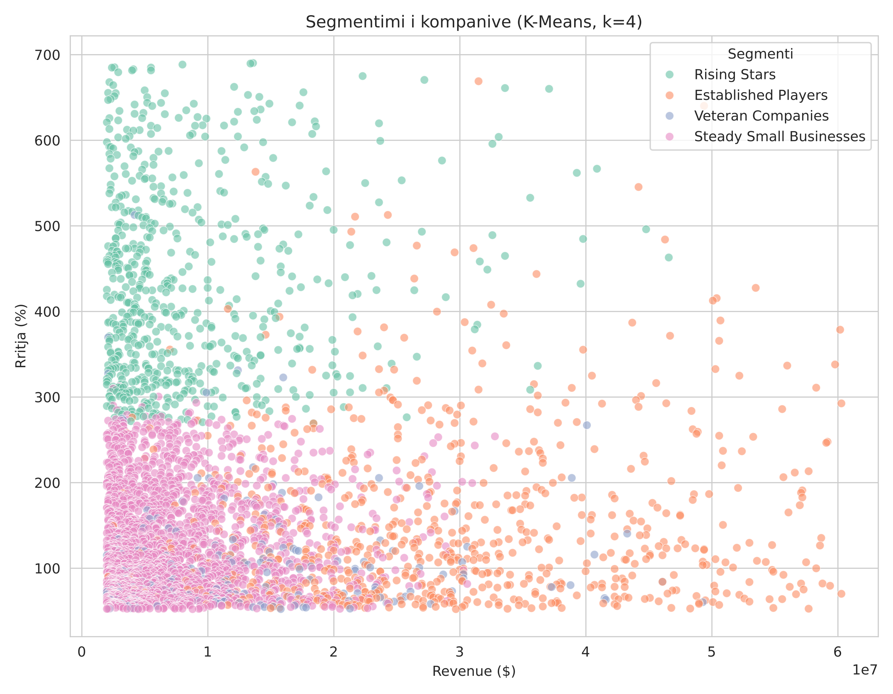

# INC 5000 (2019): Data Analysis & Company Segmentation

An end-to-end data analysis of the **5,012 fastest-growing private companies in the US** (Inc. 5000, 2019): data cleaning, exploratory analysis, feature engineering, outlier handling, regression and K-Means segmentation. Built with Python (pandas, seaborn, scikit-learn, Plotly), with a Power BI-ready dataset, theme and DAX measures included.



## Research questions

1. Which industries and states dominate the list?
2. Does a company's **size** (revenue, headcount) predict how **fast** it grows?
3. Can growth be predicted from the features in the dataset?
4. Are there natural **segments** of companies?

## Dataset

| | |
|---|---|
| Source | Inc. 5000 2019 ranking of the fastest-growing private US companies (public list; included here for educational purposes) |
| Size | 5,012 rows, 14 columns |
| Key fields | `revenue` (text, e.g. "36.9 Million"), `growth_%`, `industry`, `state`, `metro`, `city`, `workers`, `previous_workers`, `founded`, `yrs_on_list` |

## Method

| Level | Work done |
|---|---|
| **Beginner** | Load and inspect, convert `revenue` text to numeric, handle missing values, descriptive statistics, first charts |
| **Intermediate** | Group-by analysis by industry / state / metro, pivot table (state x industry), correlation matrix, feature engineering (`company_age`, `employee_growth`, `revenue_tier`, `is_repeat_lister`), multi-chart dashboard |
| **Advanced** | Interactive choropleth maps, outlier detection (IQR), regression (Linear vs Random Forest), K-Means segmentation |

Cleaning decisions are documented in the notebook. For example, `metro` (813 missing values) was filled from `city`, because smaller towns have no official metropolitan area, and the single missing `workers` value was filled with its industry median.

## Key findings

**1. Growth is heavily skewed.** Mean growth is 455% but the median is only 158%. A few extreme companies (Freestar, 36,680%) pull the average up, so medians are the more reliable summary.

**2. Size does not predict growth.** Correlation of `growth_%` with revenue is -0.01 and with headcount is -0.01. The only visible link is revenue vs workers (0.27, weak).



**3. California dominates.** 712 companies (about 14% of the list), followed by Texas (467) and Florida (385). Business Products & Services (492), Advertising & Marketing (489) and Software (461) are the biggest industries.

**4. Totals can mislead.** Minnesota ranks 2nd by total revenue with only 81 companies, because a single company (Prime Therapeutics, about $21.4B) dominates its total.



**5. Mean vs median disagree by company size.** Mean growth rises from Small (406%) to Large (491%) companies, but the median falls (179% to 139%), which is the signature of outliers among large companies.

**6. Growth is hard to predict from these features.** Random Forest reaches R² of about 0.12 (MAE about 103 percentage points); linear regression is close to zero. Revenue, company age and headcount carry similar importance, and none dominates. Growth depends mostly on factors not in the data (strategy, market timing).



**7. Four company segments (K-Means, k = 4).**

| Segment | Companies | Avg revenue | Avg growth | Avg age |
|---|---|---|---|---|
| Rising Stars | 640 | $8.7M | 431% | 7.7 yrs |
| Established Players | 720 | $29.5M | 154% | 13.8 yrs |
| Steady Small Businesses | 2,033 | $7.7M | 130% | 11.8 yrs |
| Veteran Companies | 171 | $14.3M | 110% | 45.3 yrs |



## Outlier strategy

The IQR rule flags 642 companies on growth and 615 on revenue. These are **not errors**: they are the explosive-growth companies that make the list interesting. The full dataset is used for descriptive analysis; a filtered `df_clean` (3,565 rows, 71%) is used only for modelling and clustering, where single extreme values distort results. An early linear model scored a strongly negative R² because of one company with 96,000 employees, which shows why outlier handling matters before modelling.

## Limitations

- The elbow plot has no sharp bend, so k = 4 was chosen for interpretability rather than a clear optimum.
- Model metrics, especially for linear regression, can vary slightly across library versions.
- The dataset is one year's snapshot of a list that is selected for high growth (survivorship and selection bias), so conclusions describe this list, not all US companies.

## Repository structure

```
INC5000_analysis.ipynb      Full analysis (14 steps, with outputs)
data/                       Original CSV
output/                     Charts (PNG) and interactive maps (HTML)
powerbi/                    Clean dataset export, theme and DAX measures for a Power BI dashboard
requirements.txt
```

## How to run

Run the notebook from the repository root so the `data/` and `output/` paths resolve. The notebook commentary is written in Albanian; code, charts and this README are in English.

## Tools

Python, pandas, NumPy, matplotlib, seaborn, scikit-learn, Plotly, Power BI.
